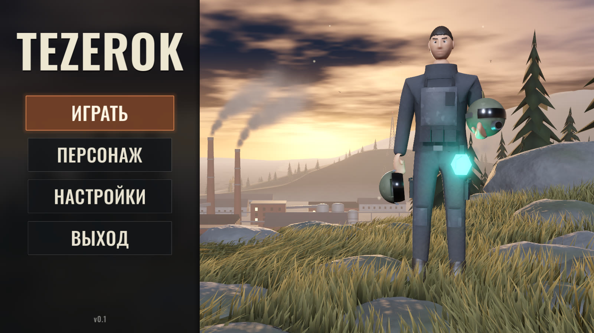
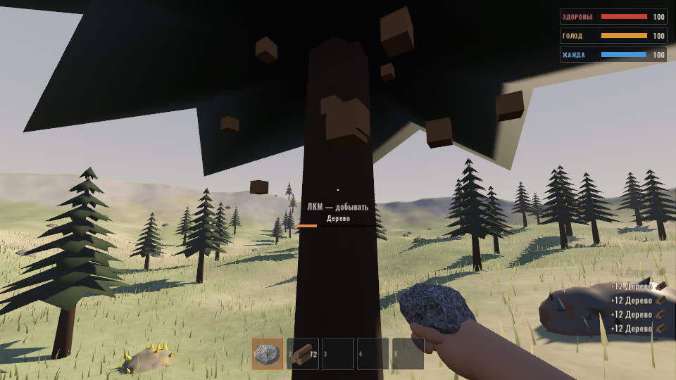

# TEZEROK

Игра на **Godot 4.7**: живое главное меню, оффлайн-сервер с добычей ресурсов, инвентарём и показателями выживания. Модели сделаны с помощью ИИ и **Blender 5.2**.



## Запуск
1. Установите [Godot 4.7](https://godotengine.org/download) (Standard, не .NET).
2. Откройте `project.godot` и нажмите **F5**. При первом открытии Godot импортирует модели — это займёт около минуты.

## Что есть в меню
- **Фотореалистичная сцена по концепту**: фон и персонаж восстановлены из концепт-арта ИИ-моделями (см. ниже) и стоят в 3D — камера слегка дрейфует и даёт параллакс за мышью.
- **Персонаж**: рельефная 3D-модель с ригом из 20 костей и зацикленной idle-анимацией на 8 секунд — дыхание, лёгкое покачивание, поворот головы, покачивание шлема в руке; модуль на бедре пульсирует голубым.
- **Живой фон**: облака плывут, из труб идёт дым, по долине ползёт дымка, трава и деревья качаются на ветру, море рябит, по земле и персонажу проходят тени облаков, мигает маяк на вышке, мерцают огни завода, летают птицы, в воздухе висят пылинки.
- **Кнопки**: «ИГРАТЬ», «ПЕРСОНАЖ» и «НАСТРОЙКИ» пока показывают подсказку «скоро» (это следующие этапы), «ВЫХОД» закрывает игру. Работают мышь, клавиатура (стрелки + Enter) и геймпад.

## Игра (этап 2)


**Играть → Сервер 1 (Оффлайн) → Подключиться** — экран загрузки, затем мир 240×240 м.

| Клавиша | Действие |
| --- | --- |
| WASD, Shift, Пробел | Ходьба, бег, прыжок |
| ЛКМ | Удар камнем — добыча |
| 1–5, колесо | Ячейки быстрого доступа |
| Tab | Инвентарь (перетаскивание мышью) |
| V | Вид от первого / третьего лица |
| Esc | Пауза: продолжить, настройки, выход в меню |

- **Добыча камнем**: дерево → «Дерево», каменная глыба → «Камни», жёлтая глыба → «Серная руда» + камни, рыжая → «Железная руда» + камни. Ресурсы трясутся и крошатся, срубленное дерево падает, всё возрождается через 2 минуты.
- **HUD** в стиле Rust: 5 ячеек снизу (выбранная подсвечена синим), справа снизу полоски здоровья, воды и еды с цифрами.
- **Вид от первого лица**: рука с камнем снизу экрана (`blender/build_viewmodel.py`, 17 костей, анимации Idle / Draw / Swing).
- **Скелет персонажа**: 19 костей на ИИ-модели (`blender/build_player_rig.py`), анимации Idle / Walk / Run / Swing — видно от третьего лица (V).
- **Настройки** (меню и пауза) применяются сразу и сохраняются: чувствительность мыши, инверсия Y, FOV, качество графики (трава, тени, SSAO, сглаживание), разрешение рендера, полный экран, VSync, лимит FPS, показ FPS, громкость.
- **ИИ-модели**: персонаж — Hunyuan3D-2 по концепт-арту (раскрашен цветами концепта, виден в «Персонаже» и от третьего лица); стартовый камень — FLUX.1-schnell → Hunyuan3D-2. Скрипты: `tools/ai_pipeline/generate_*_ai.py`, `blender/build_ai_*.py`. Дерево, руды и рука — `blender/build_game_assets.py`.

## Как сделаны модели (ИИ + Blender)
Всё работает локально на CPU, без регистраций и ключей:

| Шаг | Скрипт | ИИ-модель (лицензия) |
| --- | --- | --- |
| Глубина сцены и маска персонажа | `tools/ai_pipeline/analyze_reference.py` | Depth Anything V2 Small (Apache-2.0), rembg IS-Net (Apache-2.0) |
| Фон без персонажа и интерфейса | `tools/ai_pipeline/clean_plate.py` | LaMa (Apache-2.0) |
| Глубина в метрах, маски анимации, текстура персонажа | `tools/ai_pipeline/build_layers.py` | — |
| 3D-модель фона и риг персонажа с анимацией | `blender/build_menu_scene.py` | Blender 5.2 |

```bash
uv venv .tools/aienv --python 3.12
uv pip install --python .tools/aienv/bin/python torch torchvision --index-url https://download.pytorch.org/whl/cpu
uv pip install --python .tools/aienv/bin/python transformers "rembg[cpu]" onnxruntime opencv-python-headless huggingface_hub
.tools/aienv/bin/python tools/ai_pipeline/analyze_reference.py tools/ai_pipeline/work/reference.png
.tools/aienv/bin/python tools/ai_pipeline/clean_plate.py
.tools/aienv/bin/python tools/ai_pipeline/build_layers.py
blender -b --factory-startup --python blender/build_menu_scene.py
blender -b --factory-startup --python blender/build_props.py   # птица и текстура дыма
```

Модели пишутся в `assets/models/*.glb` (их использует Godot) и `blender/menu_scene.blend` (для правки в Blender).
Полноценную 360° модель персонажа для геймплея можно сгенерировать в TRELLIS.2 (Hugging Face, MIT), когда у бесплатной квоты есть время.

## Структура
| Путь | Что внутри |
| --- | --- |
| `scenes/main_menu.tscn` | Главное меню: панель, кнопки, интро, подсказки |
| `scenes/menu_world.tscn` | 3D-сцена меню: камера, фон, персонаж |
| `scripts/` | Логика меню, эффектов (дым, дымка, птицы, маяк, огни, пыль) и камеры |
| `shaders/` | «Живая фотография» фона, персонаж, свечения, птицы, размытие панели |
| `tools/ai_pipeline/` | ИИ-обработка концепта (глубина, маски, дорисовка фона) |
| `blender/` | Сборка 3D-моделей и файлы `.blend` |
| `assets/` | Модели `.glb`, текстуры сцены, текстура дыма, шрифт Oswald (лицензия OFL) |
